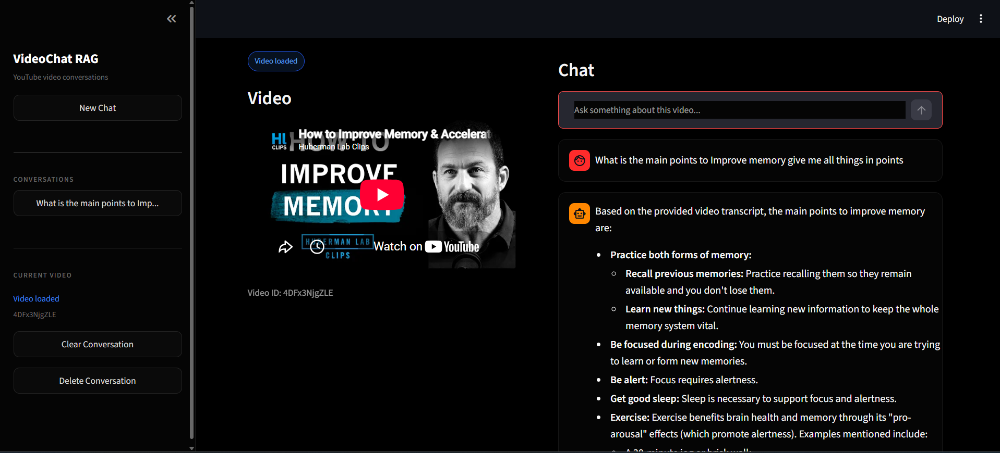
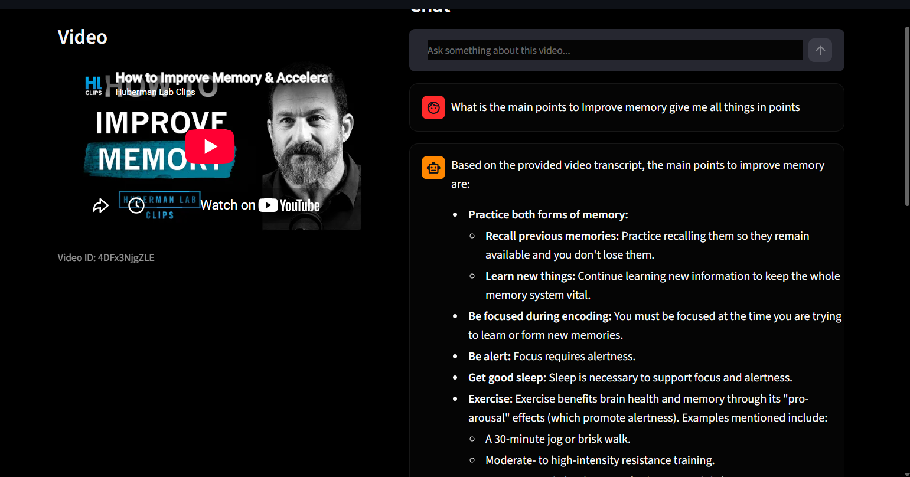

# YouTube Video RAG Chat

Ask questions about a YouTube video and get answers grounded in its transcript using Retrieval-Augmented Generation (RAG), Google Gemini, LangChain, and FAISS.

> **Project status:** In development

## Screenshots

Add your application screenshots to the `screenshots/` folder using the filenames below. The image placeholders will display once you add those files.

### 1. Home page



**Image filename:** `home-page.png`

### 2. Video chat



**Image filename:** `video-chat.png`

## Features

- Accepts a YouTube video URL.
- Retrieves the video's English transcript when available.
- Splits transcript text into smaller chunks.
- Creates embeddings using Google Gemini.
- Stores and reuses vector indexes with FAISS.
- Retrieves relevant transcript chunks to answer questions.
- Provides a Streamlit interface for video loading and chat.

## Technology stack

- **Python**
- **Streamlit** — user interface
- **YouTube Transcript API** — transcript retrieval
- **LangChain** — text splitting and RAG pipeline
- **Google Gemini** — embeddings and response generation
- **FAISS** — vector storage and similarity search
- **python-dotenv** — environment variable loading

## Project structure

```text
YouTube_Video_RAG_Chat_Project/
├── .venv/                         # Python virtual environment (local)
├── requirements.txt               # Python dependencies
└── YouTube_Video_RAG_Chat/
    ├── app.py                     # Transcript indexing and RAG logic
    ├── ui.py                      # Streamlit user interface
    ├── .env                       # API key; do not commit
    ├── .gitignore
    ├── vectorstores/              # Saved FAISS indexes
    └── screenshots/
        ├── home-page.png          # Screenshot 1: replace with your image
        └── video-chat.png         # Screenshot 2: replace with your image
```

## Prerequisites

- Python 3.11 or 3.12 recommended.
- A Google Gemini API key.
- Internet access to retrieve YouTube transcripts and call Gemini.

## Setup and run

### 1. Open the project folder

Open a terminal in the outer project directory.

### 2. Create and activate a virtual environment

**Windows PowerShell:**

```powershell
py -3.12 -m venv .venv
.\.venv\Scripts\Activate.ps1
```

If `py -3.12` is not available, check installed Python versions with `py --list` and use an installed compatible version.

### 3. Install dependencies

Make sure `requirements.txt` is in the outer project directory, then run:

```powershell
python -m pip install --upgrade pip
python -m pip install -r requirements.txt
```

### 4. Configure the API key

Create a file named `.env` inside `YouTube_Video_RAG_Chat/` and add:

```dotenv
GEMINI_API_KEY=your_actual_gemini_api_key
```

Replace the placeholder with your own key. **Never commit or share your API key.**

### 5. Start the application

From the outer project directory, run:

```powershell
python -m streamlit run .\YouTube_Video_RAG_Chat\ui.py
```

Open the local URL printed in the terminal (usually `http://localhost:8501`).

## How it works

1. Enter a YouTube video URL in the Streamlit interface.
2. The app extracts the video ID and requests an English transcript.
3. The transcript is split into chunks.
4. Gemini generates embeddings for the chunks.
5. FAISS saves the vector index for reuse.
6. When you ask a question, the retriever finds relevant transcript chunks.
7. Gemini generates an answer using the retrieved context.

## Environment variables

| Variable | Purpose |
|---|---|
| `GEMINI_API_KEY` | API key used by the Gemini embedding and chat models |

## Troubleshooting

- **Missing API key:** Check that `.env` is inside `YouTube_Video_RAG_Chat/` and contains `GEMINI_API_KEY`.
- **Transcript unavailable:** Some videos do not provide accessible English transcripts.
- **Gemini quota or model errors:** Confirm the model is available to your API key and that your API quota allows the request.
- **Dependency conflicts:** Run `python -m pip check` in the activated environment.
- **Import errors in VS Code:** Select the interpreter at `.venv\Scripts\python.exe`.

## Security notes

- Do not commit `.env`, API keys, or other secrets.
- Treat FAISS index files as trusted local data only; the application loads saved indexes using a deserialization option that should only be used with indexes you trust.
- Do not commit the virtual environment folder.

## License

Add a license before publishing or distributing this project.
